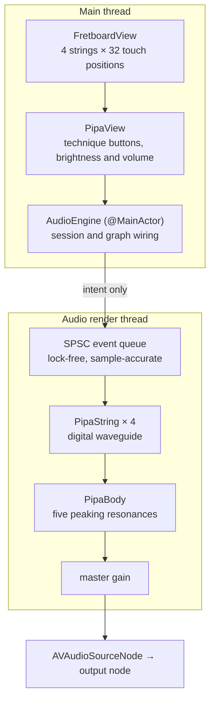
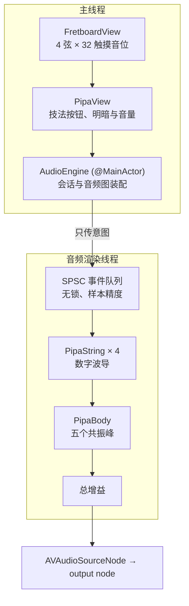

# Electric Pipa · 电子琵琶

> 本 README 英文在前、中文在后。
> This README is in English first, then Chinese.

---

# Electric Pipa

A physical-modelling synthesiser for the Pipa that runs on iPhone and iPad. Every sound is computed in real time on the device with digital waveguide algorithms. Nothing is played back from samples: the instrument is rebuilt in code, string by string, body and all.

> Personal project · grown out of my own Pipa practice, still evolving
>
> Developer: Zehui Wu (吴泽荟)
> School: Wuhan Cogdel Cranleigh High School (武汉康礼高级中学)

I have played the Pipa since childhood. Most software instruments cover the Western orchestra, and the Pipa rarely gets a physically modelled implementation, so I set out to build one myself and to understand the acoustics of my own instrument along the way. This repository is that exploration.

## Technical Contributions of This Project

### Contribution 1 · A Karplus-Strong digital waveguide as the acoustic skeleton

The core is a digital waveguide model of a single string, running the classic Karplus-Strong plucked-string algorithm:

> Fill a delay line exactly one fundamental period long with shaped noise, which stands in for the string's initial displacement. Each sample reads out of the far end, passes through a loop low-pass, is scaled by the loop gain and is written back where it came from. High frequencies lose more energy on every round trip, so the noise settles into a pitched tone. The length of the line sets the pitch; the loop low-pass sets the timbre and the tail.

References:

- Karplus, K., & Strong, A. (1983). *Digital Synthesis of Plucked-String and Drum Timbres.* Computer Music Journal, 7(2), 43-55. The original algorithm.
- Jaffe, D. A., & Smith, J. O. (1983). *Extensions of the Karplus-Strong Plucked-String Algorithm.* Computer Music Journal, 7(2), 56-69. Introduced a tunable low-pass in place of the fixed average, which is where the brightness parameter of this project's loop filter comes from.
- Smith, J. O. *Physical Audio Signal Processing* (online text, CCRMA, Stanford). The basis for the all-pass fractional delay, commuted synthesis and the physical bound on loop gain.

### Contribution 2 · Three fixes that make the whole range sound

The textbook algorithm behaves well in the low and middle registers, but on a Pipa the high positions end up "a waveform with no pitch": FFT measurements show nothing left but a cloud of low-frequency noise. Rather than stopping at the textbook implementation, this project located and fixed three faults that break the whole range. This is the real technical content of the project.

**1. The loop low-pass response has to scale with the fundamental.**

Every loss in the loop is charged per round trip, and the number of round trips per second is the fundamental frequency itself. A ratio that is harmless at 220 Hz compounds more than two thousand times a second at 2349 Hz and wipes the fundamental out instantly.

- The cutoff of the loop low-pass is no longer fixed. Bisection solves for the coefficient that puts the magnitude at the fundamental exactly on a target gain (`solveLoopCoefficient` in `PipaString.swift`). The fraction of energy kept per round trip at the fundamental is governed by one brightness parameter, so the high and low registers stay consistent.
- A side constraint: for a given loss per round trip there is a physical ceiling on the longest tail that can still fall 60 dB (`maximumDecay`). Exceeding it pushes total loop gain above 1 and the string self-oscillates, so the requested tail is clamped inside 85% of that ceiling (`applyDecay`).

**2. Fractional delay uses a first-order all-pass, not linear interpolation.**

The delay-line length is generally not an integer, and the naive implementation fills the remainder with linear interpolation. But linear interpolation is itself a low-pass, and its loss at the fundamental compounds in exactly the same way, stealing energy from the high register.

- A first-order all-pass `(a + z^-1)/(1 + a*z^-1)` carries the fractional part instead (`solveAllpassCoefficient`). Its magnitude is identically 1, so it contributes phase delay only and takes no energy away, which is precisely why it can replace linear interpolation as fractional delay.
- Total delay = integer part of the delay line + low-pass phase delay + all-pass phase delay. `actualFrequency` is computed analytically along this chain and drives the whole-range tuning check, so it depends on no signal analysis and cannot misjudge the high register.

**3. The excitation has to be strictly zero-mean.**

The loop low-pass has unity gain at DC, where decay runs tens of times slower than at the fundamental. Any non-zero mean in the excitation noise therefore survives as a low-frequency hum in the tail.

- The pluck excitation has its overall mean subtracted before normalisation (`pluck`), so the DC component is stripped completely.

### Contribution 3 · Body resonances and commuted synthesis

The four strings are separate digital waveguides. They are mixed and then fed through the body filter bank together, because on a real instrument all four strings couple into one box, so the body is applied once rather than once per string.

- Five peaking filters stand in for the resonances of the half-pear-shaped wooden box (air cavity, soundboard bending modes, high-frequency brightness), and they form the tonal skeleton that says this is a Pipa and not a guitar (`PipaBody.swift`).
- Commuted synthesis is provided: the very short excitation is convolved with the body impulse response once using `vDSP_conv` from Accelerate, and the result drives the string model. The timbre is equivalent while the cost drops by two or three orders of magnitude. The impulse response can either be measured on a real instrument or synthesised from the filter bank as a fallback (`synthesizeImpulseResponse`).
- Swapping in the impulse response measured from a real instrument is the planned next step, and it is what pulls the tone from "plastic electronics" toward "your own instrument".

### Contribution 4 · Real-time audio engineering on the render thread

`AudioEngine.swift` wires the synth into `AVAudioEngine`. CoreAudio demands that a real-time callback never allocate memory, never lock and never touch a locking random source, so the render path is built to that spec:

- The event queue is a bounded ring buffer with plain integer indices plus `OSMemoryBarrier()`, single producer on the main thread and single consumer on the render thread. Lock-free, allocation-free.
- Every write to the synth, brightness and master gain included, happens on the render thread only. The main thread just drops performance intent into the queue, which also removes any data race between the main and real-time threads.
- The pluck excitation uses an xorshift32 pseudo-random source instead of a runtime random source: deterministic, no allocation, no locking.
- Two crash-level findings from bringing this up under iOS 26 are recorded in the code comments of `AudioEngine.swift`, since both cost a full debugging cycle to find:
  - The `AVAudioSourceNode` format has to match the engine's real output format exactly, sample rate and channel count alike, and the node connects straight to the output node, bypassing the spatial mixer iOS 26 installs by default. Otherwise a converter is inserted and CoreAudio's internal assertion kills the real-time thread (`CrashIfClientProvidedBogusAudioBufferList`).
  - The render block must be built in a `nonisolated` factory. Written directly inside the `@MainActor` start method, the closure inherits MainActor isolation, and the Swift 6 runtime traps when CoreAudio calls it from the IO thread.

### Contribution 5 · Technique modelling and whole-range tuning verification

- Techniques modelled: single pluck with adjustable velocity and right-hand position, tremolo, strum in both directions, push-pull pitch bends, and damping.
- Pitch is defined in Hz, so the same note is correct at any sample rate; bends only recompute the delay and leave the timbre alone, so the tone does not jump while the pitch glides.
- The offline renderer (`Renderer/main.swift`) verifies tuning across the whole range: open strings within ±0.2 cents, all 128 positions within 0.00 cents by the analytic method, and the high register within ±0.5 cents under autocorrelation. All far inside the roughly ±5 cents a human ear can resolve.
- `PipaAudio/` carries seven 24-bit WAV pieces written by the renderer: open strings, a pentatonic scale, tremolo, strum, a push-pull slide, a short phrase, and the synthesised body impulse response.

## Field Context · From 1983 to Differentiable Physical Modelling

**The 1983 algorithm is the starting point, not the ceiling.** A textbook Karplus-Strong loop is one line of code. Everything layered on top of it in this project, the frequency-scaled loop low-pass, the all-pass fractional delay, the body filter bank and commuted synthesis, comes from extensions published in the decades after 1983, and together they form the standard modern shape of the algorithm. What is genuinely new in the 2020s is not the equations but the way the parameters are obtained.

**Differentiable physical modelling keeps the equations and changes the fitting method.** Re-implement the same physical model inside an autodiff framework and the whole chain can be fitted end-to-end by gradient descent:

- Engel, J. H., Hantrakul, L., Gu, L., & Roberts, A. (2020). *DDSP: Differentiable Digital Signal Processing.* ICLR 2020. Established differentiable DSP as a composable building block, including a differentiable Karplus-Strong loop in its teaching material.
- Tablas de Paula, P., Südholt, D., & Reiss, J. D. (2025). *Differentiable Karplus-Strong.* DMRN+20 Workshop, King's College London, Centre for Digital Music, Queen Mary University of London. A fully differentiable, time-domain extended KSA optimised end to end; gradient descent beat a genetic algorithm on an acoustic guitar dataset. The two future directions the paper names, body resonances from parallel filters and inharmonicity from an all-pass in the string loop, are both already implemented in this project.
- Diaz, R., et al. (2025). *Fast Differentiable Modal Simulation of Non-linear Strings, Membranes, and Plates.* arXiv:2505.05940. A differentiable GPU framework in JAX for nonlinear modal synthesis; it recovers tension, stiffness and geometry from recordings and runs about twice real-time at 100 modes.
- Zheleznov, V., Bilbao, S., Wright, A., & King, S. (2025). *Learning Nonlinear Dynamics in Physical Modelling Synthesis using Neural Ordinary Differential Equations.* Proceedings of DAFx25, Ancona. A hybrid model: the linear modal part stays analytic and exact, and a small network learns only the nonlinear coupling that produces pitch glides and amplitude-dependent brightness.

**Why this project keeps a physical core instead of training a neural waveform model.** A WaveNet-class model can match a timbre, but it is a black box: large, latency-heavy, and silent on why a Pipa sounds like a Pipa. A differentiable physical model stays interpretable. Every parameter remains a physical quantity that can be read off and written back into the Swift kernel, and the whole thing still runs in real time on an iPhone.

**Planned v2.0 direction.** Upgrade parameter identification from manual estimation to differentiable fitting: port the same Karplus-Strong core to PyTorch or JAX, fit the excitation spectrum, the per-string loop parameters and the body resonances by gradient descent against recordings of this instrument, and write the resulting parameter table back into `PipaString` and `PipaBody`. The optional next layer is a small network for the tension-modulation nonlinearity, the effect that makes the pitch glide under a hard pluck and that currently separates a real Pipa from this synthesiser.

## System Architecture

The signal path is short and every stage is on device. The main thread only forwards intent; all sound is computed on the audio render thread.



| Stage | Responsibility | Key file |
| --- | --- | --- |
| Interaction | Touch board, technique buttons, sliders; forwards intent only | `App/FretboardView.swift`, `App/PipaView.swift` |
| Graph wiring | Audio session, source node format, render block factory | `Audio/AudioEngine.swift` |
| Event queue | Lock-free SPSC ring buffer, sample-accurate scheduling | `Audio/AudioEngine.swift` (`PipaAudioCore`) |
| String model | Digital waveguide, loop low-pass, all-pass fractional delay | `Core/PipaString.swift` |
| Body | Five peaking resonances, commuted synthesis | `Core/PipaBody.swift` |
| Four-string engine | Per-string timbre gradient, technique scheduling | `Core/PipaSynth.swift` |
| Tuning table | Standard tuning, six xiang and twenty-five frets, pitch conversion | `Core/PipaTuning.swift` |

## Core Features

| Module | Description |
| --- | --- |
| Touch position board | 4 strings × 32 positions including the open string, with the real position markers of a Pipa soundboard. Tap any cell to sound it; drag horizontally to strum |
| Technique buttons | Strum up (fu), strum down (sao), tremolo and damping, each triggering on the sample-accurate event queue |
| Timbre and volume | Brightness slider moves the loop low-pass of all four strings; volume slider moves master gain. Both take effect on the next rendered sample |
| Offline renderer | Command-line tool that verifies tuning across the whole range and writes the seven demo WAV pieces |
| Real-time safety | Lock-free event queue, allocation-free render thread, deterministic excitation source |

## Tech Stack

- Swift 6 with SwiftUI for the interface; the DSP kernel is pure Swift with no third-party audio dependency
- iOS 17 or later, iPhone and iPad, real-time rendering through `AVAudioEngine` and `AVAudioSourceNode`
- `vDSP_conv` from the Accelerate framework for the commuted-synthesis convolution
- 48 kHz preferred session rate; the source node follows the engine's real output format, and pitch is defined in Hz so any rate stays correct
- The offline renderer is plain Swift compiled by hand with `swiftc`, outside the Xcode target

## Project Structure

```
ElectricPipa/
├── Core/                     # Pure Swift DSP kernel, no third-party dependency
│   ├── PipaTuning.swift      # Standard tuning, 6 xiang + 25 frets (32 positions), pitch conversion
│   ├── PipaString.swift      # Single-string digital waveguide, with the three fixes
│   ├── PipaBody.swift        # Body resonances, commuted synthesis, Biquad
│   ├── PipaSynth.swift       # Four-string engine, strum and tremolo scheduling
│   └── WavFile.swift         # 24-bit WAV reading and writing
├── Audio/
│   └── AudioEngine.swift     # AVAudioEngine real-time rendering, lock-free event queue
├── App/                      # SwiftUI interface
│   ├── ElectricPipaApp.swift
│   ├── PipaView.swift        # Main screen, technique buttons, brightness and volume
│   ├── FretboardView.swift   # 4 strings × 32 positions touch board, strum gesture
│   └── Info.plist
├── Renderer/
│   └── main.swift            # Offline renderer, tuning verification, demo WAV output
├── PipaAudio/                # Seven generated WAV pieces
└── ElectricPipa.xcodeproj    # Standard Xcode project, runs with Cmd+R
```

## How to Run

**The app**

1. Open `ElectricPipa.xcodeproj` with Xcode 15 or later.
2. Pick an iPhone simulator or a real device and press Cmd+R.
3. The first sound needs one user gesture, a tap on the board, because the audio session is configured as `.playback` and iOS requires it to start from a gesture.

**The offline renderer**

```
xcrun swiftc -swift-version 6 -o PipaRenderer \
  Renderer/main.swift Core/*.swift -framework Accelerate
./PipaRenderer --out ./PipaAudio
```

It prints the tuning verification tables and writes the seven WAV pieces.

> Note: the Bundle Identifier is still the placeholder `com.example.electricpipa`. Change it before debugging on a real device or shipping.

## Version History

Each round below was driven by something the previous round could not do. The first three rounds all ran into the same real-time crash, and the first two fixes turned out not to be the root cause; the third one was. The trail is kept in full because it shows how the fault was actually narrowed down.

### v1.0 · First complete edition (2026-10-17)

- Karplus-Strong digital waveguide with the three whole-range fixes, five-peak body model and commuted synthesis
- Four-string engine with per-string timbre gradient, technique scheduling and push-pull bends
- iOS app with a 4 × 32 touch board, technique buttons and brightness and volume sliders
- Offline renderer with whole-range tuning verification: open strings ±0.2 cents, 128 positions 0.00 cents analytically, high register ±0.5 cents
- 10 Swift files, seven 24-bit WAV demo pieces

### v1.1 · Real-time thread safety (2026-10-17)

- Triggering a sound crashed the audio thread with `AURemoteIO::IOThread: EXC_BREAKPOINT`. First hypothesis: the render callback broke real-time rules, with a per-frame heap allocation, an `NSLock` and a locking random source all on the IO thread
- The event queue became a lock-free SPSC ring buffer with `OSMemoryBarrier()`, and every synth write, brightness and master gain included, moved onto the render thread so the main thread only queues intent
- The pluck excitation moved from `Float.random` to an xorshift32 source: deterministic, no allocation, no locking
- Verified with an independent DSP stress run of 510,000 samples across the whole range: zero NaN, zero crash. The crash survived, so this was hardening rather than the fix, but it is kept

### v1.2 · Audio graph assembly (2026-10-17)

- Second hypothesis: the graph itself. The source node was hard-wired to mono at 48 kHz and connected to the main mixer node, which on iOS 26 is a spatial mixer, so a sample-rate and channel converter sat between source and output and CoreAudio judged its input buffer list bogus
- The session is now activated first, the real output format is read from `engine.outputNode.inputFormat(forBus: 0)`, the source node is built with that explicit format, and it connects straight to the output node. The DSP kernel is rebuilt at the real rate
- Verified on macOS with a real `AVAudioEngine` and `AVAudioSourceNode`, which ran clean and ruled out the DSP algorithm as the cause. The crash survived this too, which finally pointed away from the graph

### v1.3 · Swift 6 actor isolation, the actual cause (2026-10-17)

- With the algorithm and the graph both cleared, the crash was reproduced in the sandbox: a UIKit probe app driving the project's own `AudioEngine.swift`, launched without a debugger so the crash landed on disk as an `.ips`
- The backtrace ran through `libdispatch` and `libswift_Concurrency`, and disassembling the render closure showed it calling the lazy protocol witness accessor for `Swift.MainActor`. The closure, written inside the `@MainActor` start method, had inherited MainActor isolation, and `MainActor.assumeIsolated` trapped when CoreAudio called it from the IO thread
- The render block is now built in a `nonisolated` static factory, free of any actor isolation. Verified end to end with the probe driving the project's own `AudioEngine.swift` through strum, single pluck, tremolo, bend and damping: zero crashes

### v1.4 · English comments and bilingual README (2026-10-17)

- All code comments moved to English, with the two crash-level findings from contribution 4 written up in the code
- README rebuilt as English first with the full Chinese edition following, both covering the same sections

### v1.5 · Field context and the differentiable roadmap (2026-10-17)

- Added a field-context section to the README: where the 1983 core sits in the field, the 2020-2025 differentiable physical modelling line of work, and why the core stays physical instead of becoming a neural waveform model
- Upgraded the planned parameter identification from manual estimation to differentiable fitting, with the 2025 literature that motivates it

## Known Limitations / To Be Improved

- The five body resonances are hand-set estimates, not measurements. The planned next step is differentiable parameter identification: port the same Karplus-Strong core to PyTorch or JAX and fit the per-string 60 dB tail, the slope of the excitation spectrum and the body transfer function by gradient descent from recordings of the four open strings at three velocities, then write the results back into `PipaString` and `PipaBody`
- The excitation is white noise shaped by a comb filter, which is where the remaining guitar-like colour comes from. A real nail pluck has a spectrum that falls with frequency, and that slope is one of the parameters the differentiable fitting will supply
- The Bundle Identifier is still a placeholder
- The brightness slider moves all four strings together; per-string brightness is already in the engine and only needs surfacing in the UI
- Audio on the simulator works, but a real device is the better reference for how the tone sits

## License

Source code of a personal project; discussion and learning welcome.

---

# 电子琵琶 · Electric Pipa

一款可在 iPhone / iPad 上弹奏的**物理建模合成**电子琵琶。所有声音都在手机本地、实时用数字波导算法算出来——不是在播放采样，是把琵琶这件乐器用代码重新造了一遍，一根弦一根弦地造，连琴体一起。

> 个人项目 · 源于自己的习琴需要,在长期练习中持续打磨
>
> 开发者:吴泽荟（Zehui Wu）
> 学校:武汉康礼高级中学（Wuhan Cogdel Cranleigh High School）

我自幼学习琵琶演奏。软件乐器大多覆盖西方管弦,琵琶很少有用物理建模做的实现,于是我自己写了一个,顺带把自己这件乐器的声学原理弄明白。这个仓库就是这条探索线。

## 本项目的技术贡献

### 贡献 1 · 以 Karplus-Strong 数字波导为声学骨架

核心是一根弦的数字波导模型,采用经典的 Karplus-Strong 拨弦合成算法:

> 把一段经过塑形的噪声填入长度恰好等于一个基频周期的延迟线,作为弦的初始位移;每个样本从延迟线末端读出、过一个环路低通、乘以环路增益后写回原处。高频每绕一圈损失更多能量,噪声逐渐收敛为乐音。**延迟线的长度决定音高,环路低通的系数决定音色与余音。**

引用:

- Karplus, K., & Strong, A. (1983). *Digital Synthesis of Plucked-String and Drum Timbres.* Computer Music Journal, 7(2), 43-55. 原始算法。
- Jaffe, D. A., & Smith, J. O. (1983). *Extensions of the Karplus-Strong Plucked-String Algorithm.* Computer Music Journal, 7(2), 56-69. 提出用可调低通替代固定平均,本项目环路低通的「亮度」参数即源于此。
- Smith, J. O. *Physical Audio Signal Processing*（在线教材,CCRMA, Stanford）。分数延迟全通、Commuted Synthesis 与环路增益物理上界的推导依据。

### 贡献 2 · 让全音域都发得出声的三处修正

朴素 Karplus-Strong 在中低音区表现良好,但在琵琶的高品位会「有波形、没音高」——FFT 实测高音区只剩一团低频杂波。本项目没有停留在教科书实现,而是定位并修正了三个会让全音域失效的坑。这是本项目真正的技术含量所在。

**1. 环路低通的响应必须随基频缩放。**

环路里的任何衰减都按「每绕一圈」计,而每秒绕的圈数就等于基频。同样比例在 220 Hz 上无伤大雅,在 2349 Hz 上每秒复利两千多次,基频瞬间归零。

- 环路低通截止不再固定,而是用二分法解出「在基频处幅度恰为指定增益」的系数（`PipaString.swift` 的 `solveLoopCoefficient`）。基频处每圈能量保留比例由统一的「亮度」参数决定,高音低音一致。
- 附带约束:每圈损失给定时,衰减 60 dB 的最长余音存在物理上限（`maximumDecay`）。超过它会让总环路增益大于 1 而自激,因此期望余音被夹在上限的 85% 内（`applyDecay`）。

**2. 分数延迟用一阶全通,不用线性插值。**

延迟线长度一般不是整数,朴素实现用线性插值补零头,但线性插值本身就是低通,它在基频处的衰减同样逃不过复利,把高音能量偷走。

- 改用一阶全通 `(a + z⁻¹)/(1 + a·z⁻¹)` 承担分数延迟（`solveAllpassCoefficient`）。全通幅度恒等于 1,只贡献相位延迟,不带来任何能量损失——这正是它能替代线性插值的原因。
- 总延迟 = 延迟线整数部分 + 低通相位延迟 + 全通相位延迟。`actualFrequency` 沿这条链路解析算出,用作全音域音准校验,不依赖任何信号分析,高音区也不会误判。

**3. 激励必须严格零均值。**

环路低通在直流处增益恰好为 1,直流比基频衰减慢几十倍。只要激励均值不为零,余音尾部就会塌缩成一团低频哼声。

- 拨弦激励填入延迟线后先减去整体均值再归一化（`pluck`）,直流被彻底剥离。

### 贡献 3 · 琴体共振与 Commuted Synthesis

四根弦各自是一段数字波导,混合后再统一进入琴体滤波器组——真实乐器里四根弦耦合到同一个音箱,所以琴体只算一次。

- 用 5 个 peaking 滤波器逼近半梨形木箱的共振峰（空气腔、面板弯曲模式、高频亮度）,构成「这是琵琶而不是吉他」的音色骨架（`PipaBody.swift`）。
- 提供 Commuted Synthesis:把极短的激励与琴体脉冲响应用 Accelerate 的 `vDSP_conv` 卷积一次,再用结果驱动弦模型,音色等效但计算量下降两三个数量级。脉冲响应既可实测,也可由滤波器组合成兜底（`synthesizeImpulseResponse`）。
- 换成实测脉冲响应是既定下一步,也是把音色从「塑料电子声」拉近到「像你那把琴」的关键。

### 贡献 4 · 实时线程上的音频工程

`AudioEngine.swift` 把合成器接进 `AVAudioEngine`。CoreAudio 要求实时回调不得分配内存、不得加锁、不得调用带锁随机源,渲染链路照此构建:

- 事件队列是有界环形缓冲,用普通整数下标加 `OSMemoryBarrier()` 同步,主线程生产、渲染线程消费,全程无锁、零分配。
- 所有对合成器的改写（含亮度与总增益）都只在渲染线程发生,主线程只投递演奏意图,顺带消除主/实时线程的数据竞争。
- 激励噪声用 xorshift32 伪随机源,确定性、无分配、无锁。
- 在 iOS 26 上把这条链路跑通的过程中,两个崩溃级发现已写进 `AudioEngine.swift` 的注释,因为每一个都花了整整一轮调试才定位:
  - `AVAudioSourceNode` 的格式必须与引擎真实输出格式完全一致（采样率与声道数）,并直连 output node,绕开 iOS 26 默认装上的空间混音器;否则中间会被插入转换器,CoreAudio 内部断言直接崩掉实时线程（`CrashIfClientProvidedBogusAudioBufferList`）。
  - 渲染块必须在 `nonisolated` 工厂里创建。直接写在 `@MainActor` 的 start 方法里,闭包会继承 MainActor 隔离,CoreAudio 从 IO 线程调用时 Swift 6 运行时直接 trap。

### 贡献 5 · 技法建模与全音域音准校验

- 建模的技法:单弦拨奏（力度与右手拨弦位置可调）、轮指、双向扫弦、推拉弦滑音、止音。
- 音高以 Hz 定义,任何采样率下同一个音都准;滑音只重算延迟不动环路增益,音高过渡时音色不跳变。
- 离线渲染器（`Renderer/main.swift`）做全音域校验:四空弦 ±0.2 音分、128 个音位解析法 0.00 音分、高音区自相关 ±0.5 音分,全部远在人耳可辨的约 ±5 音分之内。
- `PipaAudio/` 收录渲染器写出的 7 段 24-bit WAV:空弦、五声音阶、轮指、扫弦、推拉弦滑音、一段乐句、合成琴体脉冲响应。

## 领域坐标 · 从 1983 到可微分物理建模

**1983 年的算法是起点,不是天花板。** 教科书版 Karplus-Strong 环路只有一行代码。本项目叠加在它之上的一切,随基频缩放的环路低通、全通分数延迟、琴体滤波器组、Commuted Synthesis,都来自 1983 年之后几十年间的扩展,合起来就是这个算法的标准现代形态。2020 年代真正的新东西不在方程,而在参数的获取方式。

**可微分物理建模保留方程,改变拟合方法。** 把同一套物理模型搬进自动微分框架,整条链就能用梯度下降端到端拟合:

- Engel, J. H., Hantrakul, L., Gu, L., & Roberts, A. (2020). *DDSP: Differentiable Digital Signal Processing.* ICLR 2020。把可微分 DSP 确立为可组合的基础件,其教学材料里就包含一个可微分的 Karplus-Strong 环路。
- Tablas de Paula, P., Südholt, D., & Reiss, J. D. (2025). *Differentiable Karplus-Strong.* DMRN+20 研讨会,伦敦国王学院,伦敦玛丽女王大学数字音乐中心。完全可微分的时域扩展 KSA,端到端优化,在吉他数据集上梯度下降优于遗传算法。论文点出的两个未来方向,琴体用并行滤波器、非谐性用弦环路里的全通,本项目都已经实现。
- Diaz, R., et al. (2025). *Fast Differentiable Modal Simulation of Non-linear Strings, Membranes, and Plates.* arXiv:2505.05940。JAX 写的可微分 GPU 模态合成框架,能从录音反演张力、刚度与几何参数,100 个模态下约为两倍实时。
- Zheleznov, V., Bilbao, S., Wright, A., & King, S. (2025). *Learning Nonlinear Dynamics in Physical Modelling Synthesis using Neural Ordinary Differential Equations.* DAFx25 会议论文集,安科纳。混合模型:线性模态部分保持解析精确,只让一个小网络学非线性耦合,而滑音与亮度随力度变化正来自这部分耦合。

**为什么本项目保留物理内核,而不是训一个神经波形模型。** WaveNet 一类模型能拟合音色,但它是黑箱:模型大、延迟高,而且回答不了「为什么琵琶像琵琶」。可微分物理模型保持可解释,每个参数都是一个可以读出来、写回 Swift 内核的物理量,整套东西还能在 iPhone 上实时跑。

**v2.0 计划方向。** 把参数辨识从手工估计升级为可微分拟合:把同一套 Karplus-Strong 内核移植到 PyTorch 或 JAX,用梯度下降对本乐器的录音端到端拟合激励谱、每弦环路参数与琴体共振峰,把得到的参数表写回 `PipaString` 与 `PipaBody`。可选的下一个层是用一个小网络学张力调制非线性,强拨时音高滑动正来自这个效应,它也是当前合成声与真实琵琶之间最大的差距。

## 系统架构

信号链很短,每一级都在本机完成。主线程只转发意图,声音全部算在音频渲染线程上。



| 阶段 | 职责 | 关键文件 |
| --- | --- | --- |
| 交互 | 触摸指板、技法按钮、滑块,只转发意图 | `App/FretboardView.swift`、`App/PipaView.swift` |
| 音频图装配 | 音频会话、源节点格式、渲染块工厂 | `Audio/AudioEngine.swift` |
| 事件队列 | 无锁 SPSC 环形缓冲,样本精度调度 | `Audio/AudioEngine.swift`（`PipaAudioCore`） |
| 弦模型 | 数字波导、环路低通、全通分数延迟 | `Core/PipaString.swift` |
| 琴体 | 五个共振峰、Commuted Synthesis | `Core/PipaBody.swift` |
| 四弦引擎 | 分弦音色梯度、技法调度 | `Core/PipaSynth.swift` |
| 音位表 | 定弦、六相二十五品、音高换算 | `Core/PipaTuning.swift` |

## 核心功能

| 模块 | 说明 |
| --- | --- |
| 触摸指板 | 4 弦 × 32 音位（含空弦）,标记按真实琵琶面板位置;点格子发声,横向拖动触发扫弦 |
| 技法按钮 | 拂弦、扫弦、轮指、止音,全部走样本精度事件队列 |
| 音色与音量 | 明暗滑块统一移动四弦环路低通,音量滑块移动总增益,都在下一个渲染样本生效 |
| 离线渲染器 | 命令行工具,做全音域音准校验并写出 7 段演示 WAV |
| 实时安全 | 无锁事件队列、渲染线程零分配、确定性激励源 |

## 技术栈

- Swift 6,界面用 SwiftUI;DSP 内核纯 Swift,无第三方音频依赖
- iOS 17 及以上,iPhone / iPad,经 `AVAudioEngine` 与 `AVAudioSourceNode` 实时渲染
- Commuted Synthesis 的卷积用 Accelerate 框架的 `vDSP_conv`
- 会话优先 48 kHz,源节点跟随引擎真实输出格式;音高以 Hz 定义,换采样率仍正确
- 离线渲染器是纯 Swift,用 `swiftc` 手工编译,不在 Xcode target 里

## 项目结构

```
ElectricPipa/
├── Core/                     # 纯 Swift DSP 内核,无第三方依赖
│   ├── PipaTuning.swift      # 定弦、六相二十五品（32 音位）、音高换算
│   ├── PipaString.swift      # 单弦数字波导,含上述三处修正
│   ├── PipaBody.swift        # 琴体共振峰、Commuted Synthesis、Biquad
│   ├── PipaSynth.swift       # 四弦引擎、扫弦与轮指调度
│   └── WavFile.swift         # 24-bit WAV 读写
├── Audio/
│   └── AudioEngine.swift     # AVAudioEngine 实时渲染、无锁事件队列
├── App/                      # SwiftUI 界面
│   ├── ElectricPipaApp.swift
│   ├── PipaView.swift        # 主界面、技法按钮、明暗与音量
│   ├── FretboardView.swift   # 4 弦 × 32 触摸指板、扫弦手势
│   └── Info.plist
├── Renderer/
│   └── main.swift            # 离线渲染器、音准校验、演示 WAV 输出
├── PipaAudio/                # 已生成的 7 段 WAV
└── ElectricPipa.xcodeproj    # 标准 Xcode 工程,Cmd+R 即跑
```

## 运行方式

**App**

1. 用 Xcode 15 或更高版本打开 `ElectricPipa.xcodeproj`。
2. 选 iPhone 模拟器或真机,Cmd+R 运行。
3. 首次发声需要一次用户手势（点一下指板）——音频会话设为 `.playback`,iOS 要求它由手势启动。

**离线渲染器**

```
xcrun swiftc -swift-version 6 -o PipaRenderer \
  Renderer/main.swift Core/*.swift -framework Accelerate
./PipaRenderer --out ./PipaAudio
```

会打印全音域音准校验表,并写出 7 段 WAV。

> 注意:Bundle Identifier 仍是占位值 `com.example.electricpipa`,真机调试或上架前必须改。

## 版本演进

下面每一轮都由上一轮做不到的事情驱动。前三轮都在追同一个实时线程崩溃,前两轮修完都不是根因,第三轮才是。完整留痕是因为它能看出这个故障是怎么被一步步收窄的。

### v1.0 · 首个完整版本（2026-10-17）

- Karplus-Strong 数字波导 + 三处全音域修正 + 五峰琴体模型 + Commuted Synthesis
- 四弦引擎带分弦音色梯度、技法调度与推拉弦滑音
- iOS 应用:4 弦 × 32 触摸指板、技法按钮、明暗与音量滑块
- 离线渲染器全音域校验:四空弦 ±0.2 音分、128 音位解析法 0.00 音分、高音区 ±0.5 音分
- 10 个 Swift 文件、7 段 24-bit WAV 演示素材

### v1.1 · 实时线程安全（2026-10-17）

- 一触发声音音频线程就崩:`AURemoteIO::IOThread: EXC_BREAKPOINT`。第一假设是渲染回调违反实时规则:每帧堆分配、`NSLock` 加锁、带锁随机源全在 IO 线程上
- 事件队列改为无锁 SPSC 环形缓冲加 `OSMemoryBarrier()`;所有合成器改写（含亮度与总增益）移到渲染线程,主线程只投递意图
- 激励从 `Float.random` 换成 xorshift32:确定性、无分配、无锁
- 独立 DSP 压力测试 51 万样本零 NaN 零崩溃。崩溃依旧,说明这一轮是加固而非修复,但改动全部保留

### v1.2 · 音频图装配（2026-10-17）

- 第二假设指向音频图:源节点被硬编码 mono / 48000 并接到 mainMixerNode,iOS 26 上它是空间混音器,源与输出之间被插入采样率/声道转换器,CoreAudio 判其输入缓冲区列表 bogus
- 改为先激活会话,读 `engine.outputNode.inputFormat(forBus: 0)` 的真实格式,源节点用该显式格式构造并直连 output node,DSP 内核按真实采样率重建
- 在 macOS 上用真实 `AVAudioEngine` + `AVAudioSourceNode` 复现验证,运行干净,排除 DSP 算法嫌疑。崩溃依旧,这才把矛头从音频图移开

### v1.3 · Swift 6 actor 隔离,真正的根因（2026-10-17）

- 算法与音频图都排除后,在沙箱内自建复现链:UIKit 探针 App 驱动本工程 `AudioEngine.swift` 本体,不带调试器启动,让崩溃正式落盘成 `.ips`
- 回溯穿过 `libdispatch` 与 `libswift_Concurrency`;反汇编渲染闭包,看到它调用 `Swift.MainActor` 的 lazy witness 访问器——写在 `@MainActor` start 方法里的闭包继承了 MainActor 隔离,CoreAudio 从 IO 线程调用时 `assumeIsolated` 检查失败直接 trap
- 渲染块改由 `nonisolated` 静态工厂创建,不带任何 actor 隔离。端到端探针驱动本工程 `AudioEngine.swift`,扫弦/单音/轮指/推弦/止音全部通过,零崩溃

### v1.4 · 注释英文化与双语 README（2026-10-17）

- 全部代码注释改为英文,贡献 4 的两个崩溃级发现写进代码注释
- README 重构为英文完整版在前、中文完整版在后,两版覆盖相同章节

### v1.5 · 领域坐标与可微分路线（2026-10-17）

- README 增加领域坐标一节:1983 年内核在领域中的位置、2020-2025 可微分物理建模这条线、以及为什么内核保持物理而不是换成神经波形模型
- 参数辨识计划从手工估计升级为可微分拟合,并补上支撑这一升级的 2025 年文献

## 已知限制 / 待改进

- 五个琴体共振峰是手拍估值,不是实测。既定下一步是可微分参数辨识:把同一套 Karplus-Strong 内核移植到 PyTorch 或 JAX,用梯度下降从四根空弦 × 三档力度的录音中拟合每弦 60 dB 余音、激励谱下降斜率与琴体传递函数,结果写回 `PipaString` 与 `PipaBody`
- 激励是白噪加梳状滤波,剩下的「吉他味」主要来自这里。真实义甲拨弦的频谱随频率下降,这条斜率正是可微分拟合要测的参数之一
- Bundle Identifier 仍是占位值
- 明暗滑块统一移动四根弦;分弦亮度引擎里已经有,只需在界面上暴露
- 模拟器上音频可用,但音色落位以真机为更可靠的参考

## 许可证

个人项目源码,欢迎交流与学习。
